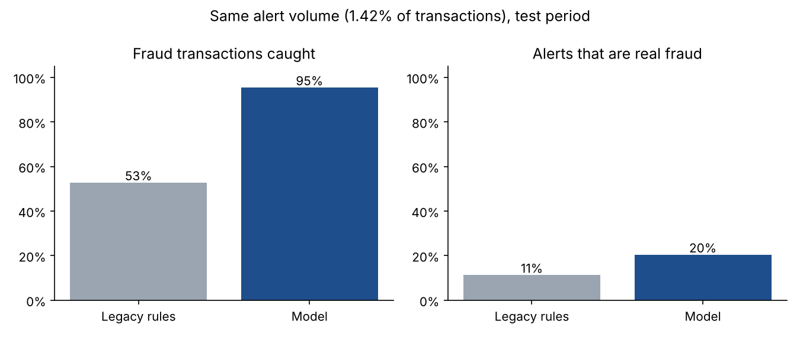
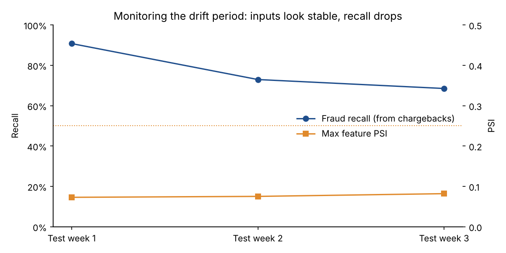
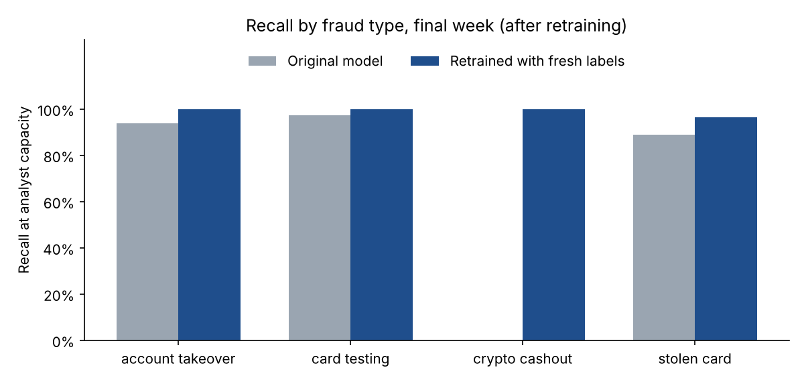

# Card Fraud Detection with MLOps on AWS: Build, Ship, Monitor, Retrain

A full machine-learning lifecycle for real-time card fraud detection: point-in-time features, a model evaluated against the fraud team's actual review capacity, a **SageMaker Pipeline** with a quality gate and model registry, a real-time endpoint with data capture, and a monitoring job. The project then puts that monitoring to work: **a new fraud pattern appears that the model has never seen, and the post-mortem shows which monitors caught it and which didn't.**

   

> **Data note:** all data is synthetic, produced by [`data/generate_data.py`](data/generate_data.py): 90 days of transactions for 8,000 cardholders (654K transactions, 0.34% fraud). Cardholders have homes, spending habits, active hours and usual devices. Legitimate noise (travel, small subscriptions, night owls, new phones) overlaps with fraud signals. Fraud comes in three patterns (card testing, account takeover, stolen card), and **a fourth, crypto cash-outs, starts only in the final two weeks.**

> **What has and hasn't been run:** the local pipeline and tests (`make all`) produced every number below. The SageMaker pipeline, deployment script and monitoring Lambda in [`aws/`](aws/) and the SageMaker entry points in [`src/`](src/) are written against the SageMaker Python SDK v2 but **have not yet been executed in an AWS account**. The training and inference entry points *are* unit-tested locally.

---

## Results at a glance

**Test period:** days 69–89, with the model trained on days 0–55 and the threshold set on days 56–68.

| | Legacy rules | **Model, same alert volume** | **Model at analyst capacity** |
|---|---|---|---|
| Alerts (share of transactions) | 1.42% | 1.42% | 0.34% |
| Fraud transactions caught | 52.8% | **95.5%** | 79.4% |
| Alerts that are real fraud | 11.3% | **20.4%** | **71.8%** |
| Fraud dollars caught | 91.7% | 89.1% | 56.1% |

- **At the same alert volume, the model catches 95% of fraud transactions vs. 53% for the rules**, with nearly twice the precision.
- **The legacy rules caught slightly more fraud *dollars*.** Their simple "amount over $1,000" rule happened to catch the large crypto cash-outs the model had never seen. That observation shaped the recommendation below.
- **At realistic analyst capacity,** 72% of alerts are real fraud, so analysts spend most of their time on actual cases.



### The drift post-mortem
In test week 2, fraudsters start cashing out through crypto exchanges, a pattern absent from training data.

| Test week | Max feature PSI | Score PSI | Fraud recall (chargebacks) | Missed fraud $ | Top missed category |
|---|---|---|---|---|---|
| 1 | 0.07 | 0.04 | **91%** | $3.1K | online retail |
| 2 | 0.08 | 0.04 | **73%** | **$56.3K** | **crypto exchange** |
| 3 | 0.08 | 0.05 | **69%** | **$52.3K** | **crypto exchange** |

- **Input-drift monitors (PSI) never fired.** Crypto cash-outs are under 0.1% of traffic, far too small to shift any feature's overall distribution.
- **Outcome monitoring caught it.** Joining confirmed fraud (chargebacks) back to scored transactions showed recall dropping and missed dollars concentrated in a single merchant category within a week.
- **Retraining with one week of new labels fixed it.** On the final week, crypto cash-out recall went from **0% to 100%** (29 transactions, a small sample) and overall fraud-dollar recall from **42% to 99.7%**.




**Recommendations:**
1. Monitor **outcomes**, not just inputs: recall and missed dollars by segment as chargebacks arrive.
2. Keep a few **broad high-amount rules** as a safety net beside the model.
3. **Retrain on a schedule** with the latest labels, gated by the pipeline's quality check.

## Approach

### 1. Point-in-time features
Every feature for a transaction uses **only that cardholder's earlier transactions**, exactly what a real-time scoring service knows when the card is swiped:

| Group | Features |
|---|---|
| Transaction | amount, log amount, hour, night flag, online/in-person, new device, distance from home, merchant category |
| Velocity | transactions in the last 1h / 24h, spend in the last 24h, small (<$5) charges in the last hour, hours since previous transaction |
| Behavior vs. history | amount ÷ the card's average, first purchase in this category, card's online share, card history length |

A unit test recomputes features on a truncated dataset and asserts they're identical, which proves no future data leaks in. **It caught a real bug during development:** a cardholder's first transaction defaulted to the *dataset-wide* median amount, which quietly used future transactions. That default is now a fixed constant.

### 2. Model and evaluation
- `HistGradientBoostingClassifier` with native categorical handling, class weighting for the 0.34% positive rate, and early stopping on PR AUC. Test PR AUC: **0.852**.
- **Time-based splits** (train → validate → test), never random, because fraud patterns change over time.
- **Evaluated at analyst capacity:** the alert threshold is set so alerts equal 0.5% of validation traffic. In the test period the same threshold produced 0.34%, because the score distribution moved, another reason to recalibrate the threshold weekly.

### 3. Monitoring
[`fraud/monitoring.py`](src/fraud/monitoring.py) computes weekly:
- **Feature PSI** against training data. Lifetime counters (card history length, account tenure) are excluded because they grow by design and would set off false alarms every week.
- **Score PSI** (on log-odds).
- **Outcome metrics** from chargebacks: recall, missed fraud dollars, and the merchant category with the most missed dollars.

## AWS architecture

```
 S3 raw transactions
        │
        ▼
 ┌─────────────────────────── SageMaker Pipeline (aws/pipeline.py) ───────────────────────────┐
 │ BuildFeatures ──► TrainModel ──► EvaluateModel ──► QualityGate (PR AUC ≥ 0.75)              │
 │ (Processing)      (SKLearn        (Processing,       ├─ pass ─► RegisterModel               │
 │                    script mode)    evaluation.json)  │          (Model Registry,            │
 │                                                      │           PendingManualApproval)     │
 │                                                      └─ fail ─► FailStep                    │
 └─────────────────────────────────────────────────────────────────────────────────────────────┘
        │ human approval in SageMaker Studio
        ▼
 aws/deploy.py ──► real-time endpoint (inference_entry.py) ──► data capture to S3
                                                                    │
 EventBridge (weekly) ──► aws/monitor_lambda.py ◄── chargeback labels (S3)
                                │
                                ▼
                 CloudWatch metrics + alarms ──► SNS ──► fraud-ops team / retraining trigger
```

| File | Role |
|---|---|
| [`src/processing_entry.py`](src/processing_entry.py) | Processing job: raw CSV → point-in-time features → time-based splits |
| [`src/train_entry.py`](src/train_entry.py) | Training job (SKLearn container, script mode) |
| [`src/evaluate_entry.py`](src/evaluate_entry.py) | Evaluation job writing `evaluation.json` for the quality gate |
| [`src/inference_entry.py`](src/inference_entry.py) | Endpoint handlers (`model_fn` / `input_fn` / `predict_fn` / `output_fn`) |
| [`aws/pipeline.py`](aws/pipeline.py) | SageMaker Pipeline definition (parameters, steps, condition, registry) |
| [`aws/deploy.py`](aws/deploy.py) | Deploys the latest approved model package with data capture |
| [`aws/monitor_lambda.py`](aws/monitor_lambda.py) | Weekly PSI + outcome monitoring → CloudWatch |

## Repository structure

```
├── data/generate_data.py          # transaction simulator with fraud patterns + late drift
├── src/
│   ├── fraud/                     # features, model, evaluation, monitoring, local pipeline
│   └── *_entry.py                 # SageMaker processing / training / evaluation / inference entry points
├── aws/                           # pipeline definition, deployment, monitoring Lambda
├── reports/                       # metrics.json, figures/, tables/weekly_monitoring.csv
├── tests/                         # point-in-time leakage test, PSI, metrics, inference round-trip
└── Makefile
```

## Run it

**Locally (about 1 minute):**
```bash
git clone https://github.com/chatnic/fraud-detection-mlops-aws.git
cd fraud-detection-mlops-aws
python -m venv .venv && source .venv/bin/activate
make setup && make all
```

**On AWS:** `pip install -r requirements-aws.txt`, upload `data/raw/transactions.csv` to `s3://<bucket>/fraud/raw/`, then:
```bash
PYTHONPATH=src python aws/pipeline.py --role-arn <SageMakerExecutionRole> --bucket <bucket> --upsert --start
# approve the model package in SageMaker Studio, then:
python aws/deploy.py --role-arn <SageMakerExecutionRole> --bucket <bucket>
```

## Next steps

- Run the pipeline in AWS and add the job logs, registry and endpoint latency figures here.
- Move velocity features into SageMaker Feature Store (online + offline) so training and serving share one source.
- Add a shadow deployment, where a retrained model scores live traffic alongside production before promotion.
- Add cost-sensitive thresholds that weigh customer friction from false declines, not just analyst time.

## License

MIT. See [LICENSE](LICENSE).
